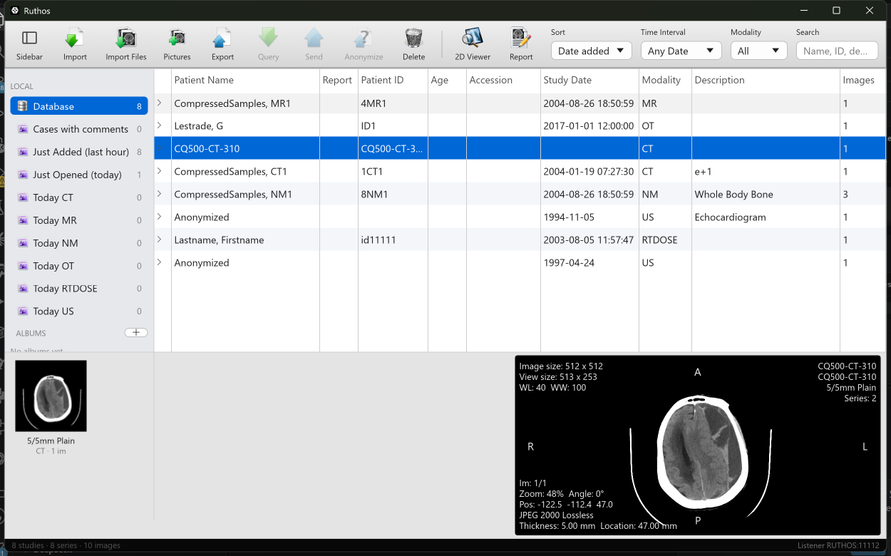
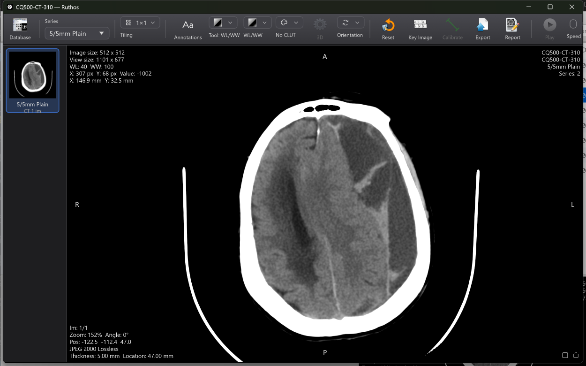

# Ruthos

**A Horos-inspired DICOM viewer for Windows, written in Rust.**

Ruthos is a community project to bring the Horos / OsiriX experience to Windows: the same database window, the same 2D viewer, the same tools, the same corner annotations, built as a single native binary on a modern GPU stack. It is not a port of Horos. Horos is Objective-C and Cocoa to the bone, so Ruthos re-implements its feature set and user interface on top of Rust libraries.

> **Status: alpha.** It works end to end on real studies and is rough in places. Today it is a patient archive with a working 2D viewer: import folders, files or pictures, a DICOM listener that receives from modalities straight into the archive, a Horos-style database window with albums, smart albums, thumbnails and a preview pane, a GPU viewer with window/level, CLUTs, zoom, pan, rotate, flip, cine, tiling, calibrated measurements (DICOM and ultrasound regions), named measurements and reports to PDF. See [RELEASE_NOTES.md](RELEASE_NOTES.md) for what the current build does and does not do, and [CONTRIBUTING.md](CONTRIBUTING.md) if you want to help.





---

## Why

Horos is the free DICOM viewer of choice in a large number of veterinary practices. It is also Mac-only, and its upstream has slowed. Practices on Windows have Weasis, OHIF in a browser, or paid tools, none of which feel like Horos. Ruthos exists to fill that gap: a free, open viewer that a Horos user can sit down at and already know how to use.

Three things justify a new codebase rather than another wrapper:

- **One small native binary.** No Java runtime, no bundled browser, no Python. Install it and open studies.
- **GPU first.** Window/level, colour lookup tables, MPR and volume rendering all run on the GPU through `wgpu`, so large CT and CBCT volumes stay interactive on ordinary clinic hardware.
- **The Horos workflow.** Albums and smart albums, the series thumbnail drawer, propagate settings, key images, ROI tools and the familiar toolbars. Where Horos made a design decision, Ruthos follows it unless there is a strong reason not to.

## What it will look like

Ruthos mirrors the two windows that make up a Horos session.

**Database window.** A source list on the left (local database, albums, smart albums, PACS nodes), an outline table of studies with series as expandable rows, a series thumbnail strip along the bottom, and the Horos toolbar: Import, Export, Query/Retrieve, Send, Anonymize, Trash, 2D Viewer, Key Images and ROIs, Report, modality and date filters, Search.

**2D viewer window.** A series thumbnail drawer on the left, the image viewport with the Horos four-corner annotation layout, and the viewer toolbar: Database, Window tiling, Series, Annotations, Patient, Tools, WL/WW and CLUT, Reconstruction, Orientation, Fusion, Export, Sync, Propagate settings, Play and Speed.

The annotation layout follows the Horos defaults:

| Position | Content |
|---|---|
| Top left | Image size, view size, WL/WW, mouse position in pixels and mm |
| Top right | Patient name, ID and age, study description, series description, series number |
| Bottom left | Zoom and rotation, image position, compression, slice thickness and location |
| Bottom right | MRI timing (TE/TR), field strength, acquisition date |
| Edge midpoints | Orientation letters |

**Tool palette.** The 2D tools from Horos: window/level, zoom, pan, rotate, length, angle, Cobb angle, dynamic angle, rectangle, oval, open and closed polygon, pencil, point, text, arrow, brush ROI, repulsor and ROI selector.

Colour lookup tables and volume-rendering presets are read directly from the Horos definition files, so "Hot Iron", "Jet", "VR Bones" and the rest look the same.

## Roadmap

Work is organised in tiers. Each tier is usable on its own.

### Tier 1: a complete 2D viewer

- Import files and folders into a local database; watch folders
- Database window with albums, smart albums, search and filters
- 2D viewer: window/level, presets, CLUTs, zoom, pan, rotate, flip, scroll, cine
- Multi-series tiling, sync and propagate settings
- Measurement and ROI tools with the ROI inspector and ROI manager
- Key images, comments and study state
- Hounsfield and pixel value readout, histograms and plots
- DICOM listener (C-STORE SCP), send (C-STORE SCU), query/retrieve (C-FIND, C-MOVE), echo
- Export to DICOM, JPEG, PNG and MP4
- Anonymisation for teaching: allowlist header profile, derived UIDs, shifted dates, ultrasound-region and template pixel masking with review, named teaching cases, sidecar for measurements, independent verification pass (see `docs/anonymiser.md`)
- Preferences window
- Import an existing Horos database folder, including albums, comments and key images

### Tier 2: 3D

- Orthogonal and oblique MPR, curved MPR, thick slab, MIP and MinIP
- GPU volume rendering with the Horos preset library
- PET-CT and other fusion
- ROI volumes and 3D position

### Tier 3: the long tail

- Surface rendering and mesh export
- Reports
- Hanging protocols
- A plugin interface (Horos plugins are Objective-C bundles and do not carry over)
- DICOM print and structured reports

Not planned: anything that depended on Apple-only services in Horos (iChat, Mail scripting, disc burning, QuickTime, iCloud).

## Architecture

Ruthos is a Cargo workspace. Each crate has a single job and a clear boundary.

| Crate | Job |
|---|---|
| `ruthos-core` | Data model (Study, Series, Image, Album), SQLite storage, import pipeline, file store, smart-album predicates, Horos database migration |
| `ruthos-dicom` | Wraps [dicom-rs](https://github.com/Enet4/dicom-rs). Decoding to typed pixel buffers, rescale, geometry, default WL, CLUT and preset loaders |
| `ruthos-net` | DICOM networking on the dicom-rs upper layer: listener, send, query/retrieve, echo |
| `ruthos-render` | `wgpu` pipelines. Tier 1: texture upload, WL/CLUT shader, ROI geometry, annotation text. Tier 2: volume pipelines |
| `ruthos-ui` | The windows, one module per Horos window, built with `egui` |
| `ruthos` | The application binary, settings, updates |

### Technology choices

- **Language:** Rust, stable toolchain, MSVC target on Windows.
- **DICOM:** dicom-rs, with its own decoders for RLE and deflate, libjpeg-turbo for JPEG, CharLS for JPEG-LS and OpenJPEG for JPEG 2000 (rather than Grok, to stay clear of AGPL).
- **Rendering:** `wgpu` over DirectX 12, with Vulkan as a fallback.
- **UI:** `egui` with a custom theme and a small set of purpose-built widgets (toolbar, source list, outline table, thumbnail strip) that give the Horos look.
- **Storage:** SQLite via `rusqlite`.
- **Minimum platform:** Windows 10 version 1809 or later, 64-bit.

### Features, not workarounds

dicom-rs is strict and standards-based, and Ruthos leans on that. Vendor-specific quirks are handled in one isolated module behind a single trait, each with a test file, so they never leak into feature code.

## Relationship to Horos

Ruthos is an independent project. It is not affiliated with or endorsed by the Horos Project or Nimble Co LLC. "Horos" and "OsiriX" are trademarks of their respective owners.

Ruthos borrows from Horos under the terms of its licence: icons, colour lookup tables, volume-rendering presets, annotation defaults, window-level presets, and the shape of its database schema. Where Horos logic is translated into Rust, the source file is credited in a comment.

## Licence

Ruthos is licensed under the **GNU Lesser General Public License v3.0**, the same licence as Horos. This is deliberate: it keeps Ruthos free to reuse Horos assets and logic, and it keeps Ruthos free.

## Building

You will need:

1. The Rust toolchain via [rustup](https://rustup.rs). Stable channel, `x86_64-pc-windows-msvc` target.
2. Microsoft Visual C++ Build Tools (the "Desktop development with C++" workload). The MSVC compiler links Rust and builds the three C/C++ codecs below.
3. [CMake](https://cmake.org/download/) on the `PATH` (or in the `CMAKE` environment variable). It builds the three C/C++ codecs: OpenJPEG (JPEG 2000), CharLS (JPEG-LS) and libjpeg-turbo (JPEG, including 12-bit).
4. [NASM](https://www.nasm.us/) on the `PATH`, optional. Without it libjpeg-turbo builds without SIMD and decodes more slowly.
5. Git.

Then:

```powershell
git clone https://github.com/Ruthos/Ruthos64.git
cd Ruthos64
cargo build --release
cargo test --workspace
```

The binary is `target\release\ruthos.exe`. The database and imported files live in `%LOCALAPPDATA%\Ruthos\Ruthos Data`, settings in `%APPDATA%\Ruthos\settings.json` (edit them in the Preferences window, Ctrl+comma), and `ruthos.log` and `crash.log` in the data folder.

Developer options, all environment variables: `RUTHOS_DATA_ROOT` (use another data folder), `RUTHOS_OPEN_STUDY`, `RUTHOS_OPEN_SERIES`, `RUTHOS_TILING` and `RUTHOS_SELECT_ROI` (open a study, series and tiling at startup with a stored measurement selected), `RUTHOS_LOUPE_AT=x,y` (show the loupe at an image point), `RUTHOS_BASIS_PANEL=1` (open the calibration basis panel), `RUTHOS_OPEN_PREFS` (open Preferences at a section), `RUTHOS_RENDERER=software` (force the CPU renderer), `WGPU_BACKEND` (dx12, vulkan or gl) and `RUTHOS_DEBUG_PANIC=viewer` (exercise the error dialog).

**Windows 11 Smart App Control.** If it is on, it will block the unsigned executables that every Rust build produces (build scripts, tests, the app). Developers need it off on their build machine. Released builds will be signed so end users can keep it on.

### Codec coverage

Verified by `crates/ruthos-dicom/tests/samples.rs` against real files:

| Transfer syntax | Status |
|---|---|
| Implicit and Explicit VR Little Endian, Big Endian, Deflated | Decodes |
| RLE Lossless | Decodes |
| JPEG Baseline, JPEG Extended 12-bit (Process 2 & 4), JPEG Lossless 8/12/16-bit | Decodes (libjpeg-turbo 3; non-standard scan headers from some modalities are repaired) |
| JPEG-LS Lossless and Near-lossless | Decodes (CharLS) |
| JPEG 2000 Lossless and Lossy | Decodes (OpenJPEG) |
| 32-bit pixel data (RT Dose) | Not yet |
| Files with no DICOM meta header | Accepted (Explicit, then Implicit VR LE) |

## Contributing

The project is at alpha, so the most useful contributions right now are:

- Horos users describing the workflows they rely on, as issues
- Sample DICOM studies that can be redistributed, especially veterinary CR, DR, CT and MRI
- Review of the architecture above before it hardens into code

If you know Horos well, the `ruthos-ui` crate is organised by Horos window name (Browser, Viewer, ThumbnailsList, Query, Send, ROI, ROIManager, Preferences and so on), so you will find your way around.

## Not for diagnostic use

Ruthos is not a medical device and has not been cleared or approved by any regulatory body. Its intended purpose is viewing, measuring and archiving veterinary images, and research and education. It is not intended for use on human patients. Do not use it as the sole basis for clinical decisions.
