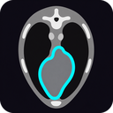
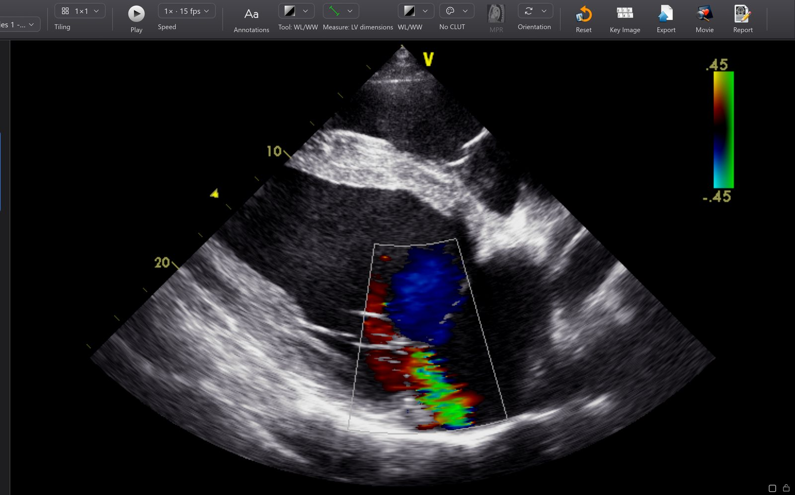
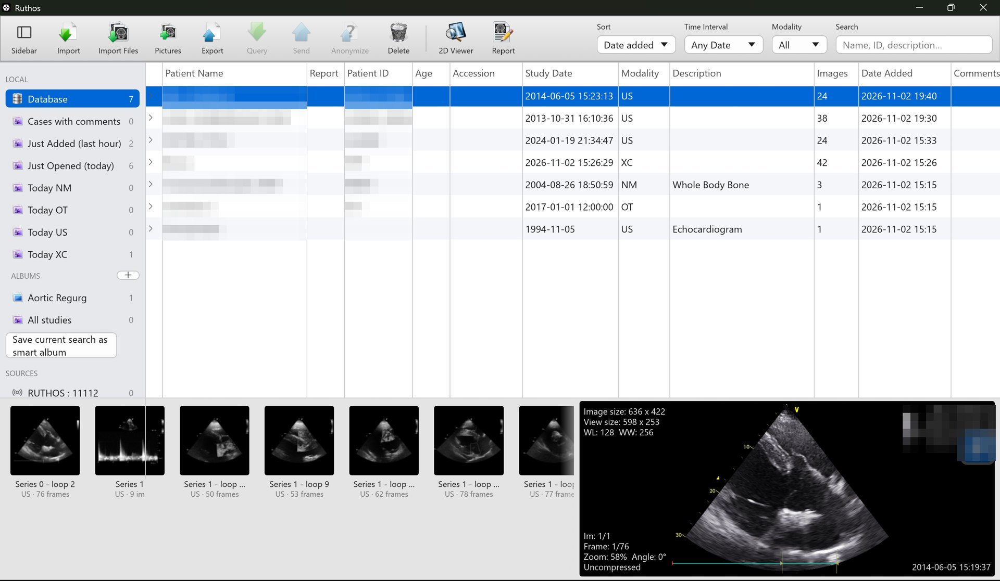
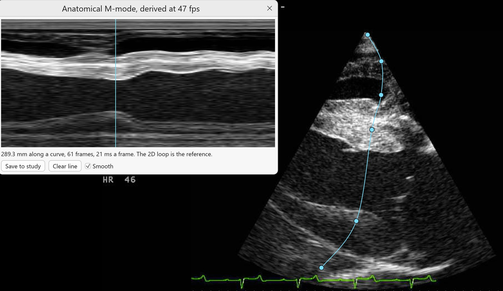

<p align="center">
  
</p>

<h1 align="center">Ruthos</h1>

<p align="center">
  <strong>A free, open-source DICOM viewer and patient archive for Windows, inspired by Horos and written in Rust.</strong><br>
  Built for veterinary practice, research and teaching.
</p>

<p align="center">
  <a href="https://github.com/Ruthos/Ruthos64/releases"></a>
  <a href="https://github.com/Ruthos/Ruthos64/actions/workflows/ci.yml"></a>
  <a href="LICENSE"></a>
  
</p>

<p align="center">
  <a href="https://ruthos.github.io/Ruthos64/">Website</a> ·
  <a href="https://github.com/Ruthos/Ruthos64/releases/latest">Download</a> ·
  <a href="#macos-alpha">macOS (alpha)</a> ·
  <a href="#documentation">Documentation</a> ·
  <a href="RELEASE_NOTES.md">Release notes</a> ·
  <a href="CONTRIBUTING.md">Contributing</a>
</p>

> [!WARNING]
> **Not for diagnostic use.** Ruthos is not a medical device and has no regulatory clearance. It is for veterinary, research and teaching use, not for human patients, and must not be the sole basis of a clinical decision.

> [!NOTE]
> **Status: alpha.** Ruthos works end to end on real studies and is rough in places. The archive format may change before 1.0, so keep your original files.



## About

Horos is the free DICOM viewer of choice in a large number of veterinary practices. It is also Mac-only, and its upstream has slowed. Practices on Windows have Weasis, OHIF in a browser, or paid tools, none of which feel like Horos. Ruthos fills that gap: a free, open viewer that a Horos user can sit down at and already know how to use.

It is not a port. Horos is Objective-C and Cocoa to the bone, so Ruthos re-implements its feature set and user interface in Rust:

- **One small native binary.** No Java runtime, no bundled browser, no Python. Unzip it and open studies.
- **GPU first.** Window/level, colour lookup tables, MPR and volume rendering all run on the GPU through `wgpu`, so large CT and CBCT volumes stay interactive on ordinary clinic hardware.
- **The Horos workflow.** Albums and smart albums, the series thumbnail drawer, key images, ROI tools and the familiar toolbars. Where Horos made a design decision, Ruthos follows it unless there is a strong reason not to.

## Features



### Archive and database

- Import files, folders, drag-and-drop, watch folders, or a whole Horos or OsiriX database with its albums, smart albums, comments, status and key images; or catalogue a drive where it is, without copying it.
- A Horos-style database window: a source list (local database, smart folders, albums, PACS nodes, catalogued drives, and the listener while it is on), studies with series as expandable rows, a thumbnail strip, a preview, search and modality and date filters, and a toolbar for import, export, Query/Retrieve, send, share, anonymise and reports.
- Import JPEG and PNG photographs as DICOM, with a patient form or a Modality Worklist.
- Preferences as in Horos: it opens on Show All, every pane an icon in groups, including Manage (which smart folders and albums the sidebar shows, and their order) and Import.

### 2D viewer

- GPU window/level and presets, Horos's colour lookup tables read from its own definition files, and five CT colour maps tied to Hounsfield values.
- Zoom, pan, rotate, flip, scroll, cine at the file's frame rate, tiling of a series or a study with a lock per cell, key images, and export to DICOM, PNG, JPEG and MP4.
- The Horos four-corner annotations and toolbar: Database, Series, Tiling, Play and Speed, Annotations, Tool and Measure, WL/WW, colour table, MPR, Orientation, Reset, Key Image, Export, Movie, Report and Anonymize.

<details>
<summary>The corner annotation layout</summary>

| Position | Content |
|---|---|
| Top left | Image size, view size, WL/WW, mouse position in pixels and mm |
| Top right | Patient name, ID and age, study description, series description, series number |
| Bottom left | Zoom and rotation, image position, compression, slice thickness and location |
| Bottom right | MRI timing (TE/TR), field strength, acquisition date |
| Edge midpoints | Orientation letters |

</details>

### Measurements and reports

- The Horos 2D tools: caliper (length, time, velocity), LV dimensions with fractional shortening in M-mode and 2D, angle, Cobb angle, angle between two lines, rectangle, ellipse, open and closed polygon, pencil, point, text, arrow, brush ROI, and the repulsor, which pushes an outline in or out to follow an edge.
- Every value states its scale basis: ultrasound region, calibrated pixel spacing, patient plane, estimated magnification, detector plane, hand calibration or uncalibrated.
- On M-mode the caliper keeps to depth or time, and lets go past 45 degrees for a slope.
- Editable handles with undo, a GPU loupe, ROI Info, the ROI Manager, histograms and line plots, and a library of definitions, sets and calculations (Teichholz, LA/Ao, VHS and more), shared as JSON.
- Reports to PDF with the key images; measurements saved into the study as DICOM structured reports (TID 1500) and key image documents, so they travel with it; and exports as CSV or JSON for research and audit.

See [docs/measurements.md](docs/measurements.md).

### Echo

- **Anatomical M-mode.** Draw a straight line at any angle, or a curve through several points, on a 2D loop, and a time and depth strip follows live. A curve can follow a wall that no line from the probe could. Saved to the study, the strip is an M-mode image the caliper and LV tools measure.
- **Timeline.** Stills and loops in the order the machine stored them, with times and long pauses, instead of each loop as a series of its own. Page Up and Page Down move along the exam.

A strip has only the frames of its loop, far fewer than the thousand or so lines a second of a true M-mode, so it suits dimensions better than fine timing; every strip and report states the rate it was derived at.



### 3D, MPR and segmentation

- Orthogonal and oblique MPR with linked crosshairs, and thick slab MIP, MinIP and mean.
- GPU volume rendering with Horos's 29 presets, an editor for colours and opacity, and live cuts kept with the study.
- Segments by threshold, region grow, islands and morphology, saved as DICOM SEG; smooth surfaces, and mesh export to STL, OBJ, PLY and 3MF for 3D printing.
- Optional AI segmentation on your own machine (Windows only): SAM 2.1, and VISTA3D and nnInteractive in Research mode.

### Networking and sharing

- A DICOM listener, send, query/retrieve, echo and automatic routing, with worklist and storage commitment. See [docs/pacs.md](docs/pacs.md).
- DICOMweb search, retrieve and send over HTTPS, tested against Orthanc.
- **Share** a patient's images with an owner or a referring vet as a folder or zip that opens with no installation: a renamed copy of Ruthos, a page for any device, the report, key images as JPEG and a DICOMDIR.
- Anonymised teaching copies, with pixel masking and an independent verification pass, and guided review of a teaching case.

### Dials

On Windows, a Surface Dial, an ASUS Dial or a ProArt DialPad steps frames and slices and fine-tunes window width and level, a measurement point and the loupe. A press changes the mode. See [docs/dial.md](docs/dial.md).

<details>
<summary>Dial actions and their keyboard shortcuts</summary>

| Action | Anticlockwise | Clockwise |
|---|---|---|
| Navigate | Ctrl+Shift+Left | Ctrl+Shift+Right |
| Window width | Ctrl+Shift+Down | Ctrl+Shift+Up |
| Window level | Ctrl+Shift+Page Down | Ctrl+Shift+Page Up |
| Measurement point | Alt+Left | Alt+Right |
| Loupe magnification | Ctrl+Shift+Minus | Ctrl+Shift+Plus |
| Next mode | | Ctrl+Shift+M |

</details>

## Download and install

1. Download `Ruthos-<version>-win64.zip` from the [latest release](https://github.com/Ruthos/Ruthos64/releases/latest) or the [website](https://ruthos.github.io/Ruthos64/).
2. Unzip it anywhere and run `ruthos.exe`. Nothing is installed.

**Requirements:** Windows 10 version 1809 or later, or Windows 11, 64-bit.

Releases are not yet code-signed (see [Code signing policy](#code-signing-policy)), so Windows SmartScreen warns on first run: choose **More info**, then **Run anyway**. A PC with Smart App Control switched on refuses unsigned programs. Every release carries checksums and a build-provenance attestation; verify a download with:

```
gh attestation verify Ruthos-<version>-win64.zip --repo Ruthos/Ruthos64
```

### macOS (alpha)

A test build for Apple Silicon Macs (M1 to M4) is available: open the [macOS test build](https://github.com/Ruthos/Ruthos64/actions/workflows/macos-test.yml) page, choose the latest successful run, and download **ruthos-macos-test** under Artifacts (you need to be signed in to GitHub; each build is kept for 14 days). It is earlier than the Windows alpha: nobody has used Ruthos on a Mac day to day yet, and the AI segmentation tool is Windows-only.

The Mac build is not yet signed by Apple, so macOS refuses it the first time: open **System Settings > Privacy & Security** and choose **Open Anyway**. [docs/macos-testing.md](docs/macos-testing.md) has the steps, a checklist of what to try, and how to report what you find.

Linux is built and tested in CI but not yet released.

### Uninstalling

Quit Ruthos and delete the folder you unzipped. To remove the archive as well, delete `%LOCALAPPDATA%\Ruthos` (this deletes every imported study, so export what you need first), and `%APPDATA%\Ruthos` for the settings.

## Getting started

- **Import:** drag folders or files onto the database window, or use Import in its toolbar. To bring your Horos library across, use **Preferences > Import** (see [docs/moving-from-horos.md](docs/moving-from-horos.md)).
- **View:** double-click a study to open it in the viewer.
- **Receive from a modality:** turn the listener on in **Preferences > Listener**, point the modality at this computer with AE title `RUTHOS` and port `11112`, and allow Ruthos through Windows Firewall when asked.
- **Preferences:** Ctrl+comma.

The archive and logs live in `%LOCALAPPDATA%\Ruthos\Ruthos Data`, and the settings in `%APPDATA%\Ruthos\settings.json`.

## Documentation

| Guide | What it covers |
|---|---|
| [Moving from Horos](docs/moving-from-horos.md) | Importing a Horos or OsiriX database |
| [Cataloguing a drive](docs/catalogue-drive.md) | Using studies where they are, without copying them |
| [PACS](docs/pacs.md) | Listener, query/retrieve, send and routing |
| [DICOMweb](docs/dicomweb.md) | DICOMweb servers, and what has been tested |
| [Measurements](docs/measurements.md) | Tools, scale basis, the library, reports and SR |
| [MPR](docs/mpr.md) | Multiplanar reconstruction |
| [Segmentation](docs/segmentation.md) | Segments, surfaces, 3D printing and the AI tool |
| [Sharing](docs/sharing.md) | Sharing images with an owner or referring vet |
| [Anonymiser](docs/anonymiser.md) | Teaching copies |
| [Guided review](docs/guided-review.md) | Reviewing a teaching case together |
| [Dials](docs/dial.md) | Surface Dial, ASUS Dial and ProArt DialPad |
| [Cross-platform](docs/cross-platform.md) | What differs on macOS and Linux |
| [Trying it on a Mac](docs/macos-testing.md) | The macOS test build and what to check |

## Roadmap

Tiers 1 and 2 are what Ruthos does today; tiers 3 and 4 are what it does not do yet.

<details>
<summary>Tier 1: a complete 2D viewer and archive (done)</summary>

- Import files and folders into a local database; watch folders; catalogue a whole drive without copying it (see `docs/catalogue-drive.md`)
- Import an existing Horos or OsiriX database, including albums, smart albums, comments, status and key images (see `docs/moving-from-horos.md`)
- Import JPEG and PNG pictures as DICOM with a patient form
- Database window with albums, smart albums, search and filters
- 2D viewer: window/level, presets, CLUTs, zoom, pan, rotate, flip, scroll, cine
- Tiling of a series or a study, with a lock per cell
- Measurement and ROI tools with ROI Info and the ROI Manager
- Measurements with a stated scale basis, editable handles with undo, a GPU loupe, a Measurements menu, an LV tool with fractional shortening in M-mode and 2D, and a library of definitions, sets and calculations with JSON import and export (see `docs/measurements.md`)
- Echo: anatomical M-mode along a line or curve, and a timeline of stills and loops
- Key images, comments and study state
- Pixel value readout, histograms and line plots
- DICOM listener (C-STORE SCP), send (C-STORE SCU), query/retrieve (C-FIND, C-GET, C-MOVE), echo and automatic routing, Modality Worklist for pictures, and storage commitment after sending (see `docs/pacs.md`)
- Reports to PDF with named measurements, calculations and key images
- Measurements, calculations and findings saved into the study as DICOM structured reports (TID 1500) and key images as key object selection documents, and read back from other software, so they travel with the study
- Measurements, calculations and reports exported as CSV or JSON, with or without identity, for research, audit and teaching (see `docs/measurements.md`)
- Export to DICOM, JPEG, PNG and MP4
- Anonymisation for teaching: allowlist header profile, derived UIDs, shifted dates, ultrasound-region and template pixel masking with review, named teaching cases, sidecar for measurements, independent verification pass (see `docs/anonymiser.md`)
- Preferences window

</details>

<details>
<summary>Tier 2: 3D, segmentation and reaching beyond the practice (done)</summary>

- Orthogonal and oblique MPR with linked crosshairs, and thick slab MIP, MinIP and mean (see `docs/mpr.md`)
- GPU volume rendering with presets, MIP and MinIP, fixed views and a movable rotation centre
- Live cutting in 3D by box, standard cuts, path and connected piece, kept with the study
- Horos's 29 volume rendering presets, and an editor for colours and opacity with presets of your own
- Segments: threshold, region grow, islands and morphology, on the slices and in 3D, with volumes and a colour for each (see `docs/segmentation.md`)
- Segments saved and reloaded as DICOM SEG, passing `dciodvfy` and highdicom in CI; opening them in other viewers is not yet confirmed
- Surfaces of segments in the 3D pane, and mesh export to STL, OBJ, PLY and 3MF, with decimation that keeps a model closed
- AI segmentation on the user's machine with SAM 2.1 (Windows); VISTA3D and nnInteractive in Research mode, installed from a folder
- DICOMweb: search, retrieve and send over HTTPS, tested against Orthanc; sign-in through Cloudflare Access is built but not yet tried on a real gateway (see `docs/dicomweb.md`)
- Sharing with an owner or a referring vet, with a DICOMDIR writer and reader (see `docs/sharing.md`)
- Guided review of a teaching case through a session relay (see `docs/guided-review.md`)

</details>

### Tier 3: next

- Curved MPR; reference lines and 3D position across series in the 2D viewer
- Scrolling linked across series, and settings propagated between them
- Reading Horos report files and saved measurements (ROIs)
- DICOMweb against dcm4chee-arc and cloud services; IHE AIW-I and UPS-RS
- VISTA3D and nnInteractive downloadable from within Ruthos; the AI tool on macOS and Linux
- Signed macOS releases, an installer and a Microsoft Store listing

### Tier 4: the future

- API ready for practice management systems (PMS). Comments, measurements, reports and annotated still images are produced through one documented, versioned interface, so a PMS can be told when a study is reported and receive its findings, values and key images with their annotations. No particular PMS integration is promised yet; the principle is that connecting one needs a small connector, not changes to Ruthos
- PET-CT and other fusion
- Hanging protocols
- A plugin interface (Horos plugins are Objective-C bundles and do not carry over)
- DICOM print

Not planned: anything that depended on Apple-only services in Horos (iChat, Mail scripting, disc burning, QuickTime, iCloud).

## Building from source

You will need:

1. The Rust toolchain via [rustup](https://rustup.rs). Stable channel, 1.92 or later, `x86_64-pc-windows-msvc` target.
2. Microsoft Visual C++ Build Tools (the "Desktop development with C++" workload). The MSVC compiler links Rust and builds the three C/C++ codecs below.
3. [CMake](https://cmake.org/download/) on the `PATH` (or in the `CMAKE` environment variable). It builds the three C/C++ codecs: OpenJPEG (JPEG 2000), CharLS (JPEG-LS) and libjpeg-turbo (JPEG, including 12-bit).
4. [NASM](https://www.nasm.us/) on the `PATH`, optional. Without it libjpeg-turbo builds without SIMD and decodes more slowly.
5. Git.

Then:

```powershell
git clone https://github.com/Ruthos/Ruthos64.git
cd Ruthos64
cargo build --release
cargo test --workspace
```

The binary is `target\release\ruthos.exe`; `ruthos.log` and `crash.log` are in the data folder.

**Windows 11 Smart App Control.** If it is on, it blocks the unsigned executables that every Rust build produces (build scripts, tests, the app). Developers need it off on their build machine. Released builds will be signed so end users can keep it on.

**macOS and Linux.** The code is cross-platform and CI tests it on all three (`.github/workflows/ci.yml`), but Ruthos is built and used on Windows today. On macOS you need Rust, the Xcode command-line tools (`xcode-select --install`) and CMake (`brew install cmake`); on Linux, Rust, CMake, NASM and the GTK 3, xkbcommon, Wayland and X11 development packages. `cargo build --release` then works the same way. Data lives in `~/Library/Application Support/Ruthos` on macOS and under the XDG directories on Linux. See [docs/cross-platform.md](docs/cross-platform.md).

<details>
<summary>Developer options (environment variables)</summary>

`RUTHOS_DATA_ROOT` (use another data folder), `RUTHOS_OPEN_STUDY`, `RUTHOS_OPEN_SERIES`, `RUTHOS_OPEN_IMAGE`, `RUTHOS_TILING` and `RUTHOS_SELECT_ROI` (open a study, series and tiling at startup with a stored measurement selected), `RUTHOS_LOUPE_AT=x,y` (show the loupe at an image point), `RUTHOS_BASIS_PANEL=1` (open the calibration basis panel), `RUTHOS_ZOOM=0.8` (scale the interface), `RUTHOS_SETTINGS=<file>` (use another settings file), `RUTHOS_OPEN_QUERY=<PACS index>` (open Query/Retrieve and search), `RUTHOS_QUERY_EXPAND=1` (show the first result's series), `RUTHOS_OPEN_PREFS` (open Preferences at a section), `RUTHOS_RENDERER=software` (force the CPU renderer), `WGPU_BACKEND` (dx12, metal, vulkan or gl) and `RUTHOS_DEBUG_PANIC=viewer` (exercise the error dialog).

</details>

<details>
<summary>Codec coverage</summary>

Verified by `crates/ruthos-dicom/tests/samples.rs` against real files:

| Transfer syntax | Status |
|---|---|
| Implicit and Explicit VR Little Endian, Big Endian, Deflated | Decodes |
| RLE Lossless | Decodes |
| JPEG Baseline, JPEG Extended 12-bit (Process 2 & 4), JPEG Lossless 8/12/16-bit | Decodes (libjpeg-turbo 3; non-standard scan headers from some modalities are repaired) |
| JPEG-LS Lossless and Near-lossless | Decodes (CharLS) |
| JPEG 2000 Lossless and Lossy | Decodes (OpenJPEG) |
| 32-bit pixel data (RT Dose) | Not yet |
| Files with no DICOM meta header | Accepted (Explicit, then Implicit VR LE) |

</details>

### Architecture

Ruthos is a Cargo workspace. Each crate has a single job and a clear boundary.

| Crate | Job |
|---|---|
| `ruthos-core` | Data model (Study, Series, Image, Album), SQLite storage, settings, import pipeline, file store, smart-album predicates, reports, sharing, Horos database migration |
| `ruthos-dicom` | Wraps [dicom-rs](https://github.com/Enet4/dicom-rs). Decoding to typed pixel buffers, rescale, geometry, default WL, CLUT and preset loaders, DICOMDIR, SEG and anatomical M-mode |
| `ruthos-net` | DICOM networking on the dicom-rs upper layer: listener, send, query/retrieve, echo; and DICOMweb over HTTPS |
| `ruthos-render` | `wgpu` pipelines: texture upload, WL/CLUT shader, ROI geometry, annotation text, and the volume ray marcher |
| `ruthos-segment` | Segments: label maps, classical tools, surface meshes and export, and the optional AI tool (Cargo feature `ai`) |
| `ruthos-session` | The client side of guided teaching sessions through a session relay |
| `ruthos-ui` | The windows, one module per Horos window, built with `egui` |
| `ruthos` | The application binary |

- **Language:** Rust, stable toolchain, MSVC target on Windows.
- **DICOM:** dicom-rs, with its own decoders for RLE and deflate, libjpeg-turbo for JPEG, CharLS for JPEG-LS and OpenJPEG for JPEG 2000 (rather than Grok, to stay clear of AGPL).
- **Rendering:** `wgpu` over DirectX 12, with Vulkan and OpenGL as fallbacks, and Windows' software renderer as a last resort.
- **UI:** `egui` with a custom theme and a small set of purpose-built widgets (toolbar, source list, outline table, thumbnail strip) that give the Horos look.
- **Storage:** SQLite via `rusqlite`.

dicom-rs is strict and standards-based, and Ruthos leans on that. Vendor-specific quirks are handled in one isolated module behind a single trait, each with a test file, so they never leak into feature code.

## Contributing

The project is at alpha, so the most useful contributions right now are:

- Horos users describing the workflows they rely on, as issues
- Sample DICOM studies that can be redistributed, especially veterinary CR, DR, CT and MRI
- Trying it on real studies and reporting what breaks: a file that does not import or display correctly is the most useful report, using the "file does not import" issue template with `ruthos.log` attached

If you know Horos well, the `ruthos-ui` crate is organised by window (`browser.rs`, `viewer.rs`, `mpr.rs`, `query.rs`, `roi.rs`, `prefs.rs` and so on), so you will find your way around. See [CONTRIBUTING.md](CONTRIBUTING.md).

## Security and privacy

To report a vulnerability, see [SECURITY.md](SECURITY.md).

Ruthos does not transmit any data to its developers or to third parties. It makes network connections only when the user configures them or asks for them: the DICOM listener, which is off by default and receives only what the user's own devices send it; DICOM and DICOMweb connections the user initiates; a guided review server the user chooses to join; the optional AI model, fetched once on request; and Cisco's video encoder, fetched once from Cisco with the user's consent, the first time a movie is exported, which tells Cisco only what any download does.

## Code signing policy

Ruthos has applied to the [SignPath Foundation](https://signpath.org) for free code signing of its Windows releases, and the application is pending. Until it is accepted, releases are unsigned: Windows SmartScreen warns on first run, and a PC with Smart App Control switched on refuses to run them.

Once accepted, free code signing on Windows will be provided by [SignPath.io](https://about.signpath.io), with a certificate by the SignPath Foundation, and macOS builds will be signed with an Apple Developer ID and notarised by Apple. Every release, signed or not, is built from this repository by the release workflow on GitHub-hosted runners, from a tagged commit, and carries SHA256 checksums and a GitHub build-provenance attestation; verify a download with `gh attestation verify <file> --repo Ruthos/Ruthos64`.

Team roles:

- Committers and reviewers: Mark Bowen
- Approvers of signing requests: Mark Bowen

## Licence

Ruthos is licensed under the **GNU Lesser General Public License v3.0** ([LICENSE](LICENSE)), the same licence as Horos. This is deliberate: it keeps Ruthos free to reuse Horos assets and logic, and it keeps Ruthos free.

## Acknowledgements

Ruthos was created by Mark Bowen. It is built on [DICOM-rs](https://github.com/Enet4/dicom-rs) by Eduardo Pinho and contributors, including Paul Knopf (upper-layer networking) and Peter Evers (pixel data), which provides its DICOM parsing, pixel decoding and networking. The interface is built with [egui](https://github.com/emilk/egui) by Emil Ernerfeldt and contributors, and rendering uses [wgpu](https://wgpu.rs). Image decoding uses libjpeg-turbo, OpenJPEG and CharLS; this software is based in part on the work of the Independent JPEG Group. Ruthos's workflow, icons, colour tables and presets follow Horos, its interface uses the Inter typeface and Phosphor icons, and its test files come from pydicom. The full licence text of every component is in THIRD_PARTY_LICENSES, which every package carries, and the About window opens it.

OpenH264 Video Codec provided by Cisco Systems, Inc. The encoder is not part of Ruthos: it is fetched from Cisco, with your consent, the first time you export a movie.

### Relationship to Horos

Ruthos is an independent project. It is not affiliated with or endorsed by the Horos Project or Nimble Co LLC. "Horos" and "OsiriX" are trademarks of their respective owners.

Ruthos borrows from Horos under the terms of its licence: icons, colour lookup tables, volume-rendering presets, annotation defaults, window-level presets, and the shape of its database schema. Where Horos logic is translated into Rust, the source file is credited in a comment.
